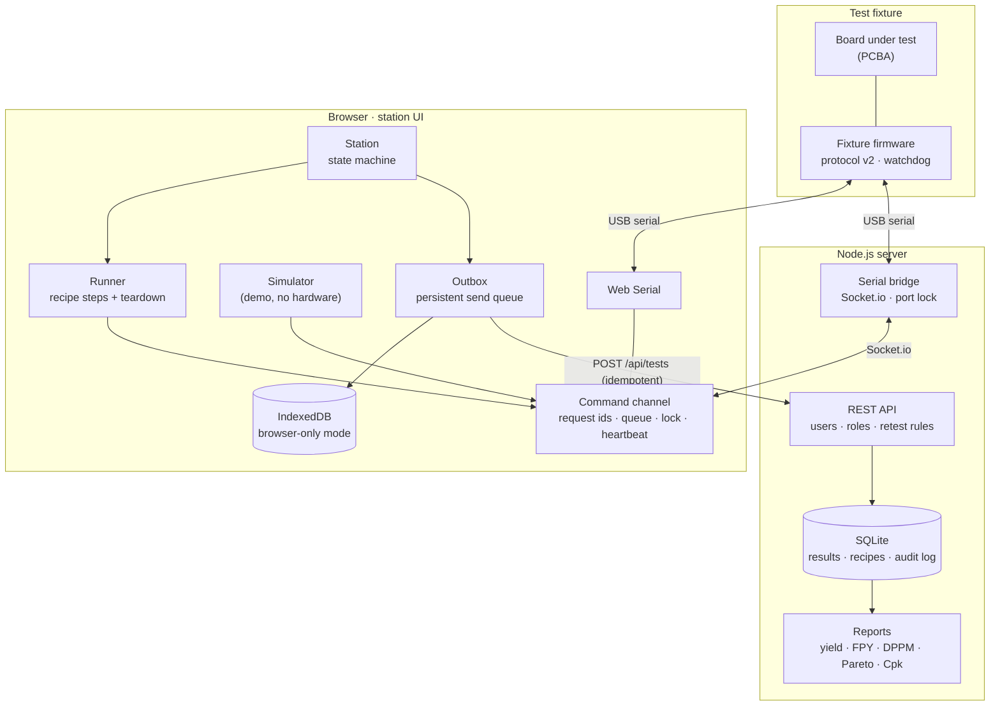

# PCBA Test Station

[](https://github.com/sahintaha/pcba-test-station/actions/workflows/ci.yml)
[](LICENSE)

**English** · [Türkçe](README.tr.md)

A web-based **functional test station** for assembled circuit boards. The operator scans a board's serial number, the station sends commands to the board step by step and checks every measurement against the limits in the product's test recipe. The result is stored as PASS / FAIL / ERROR together with whether the board was left in a safe state, and every record is traceable: who tested it, at which station, with which recipe revision. Yield, Pareto and Cpk reports come from the same data.

It runs in the browser with no installation (Web Serial), or with a Node.js server for multiple users and a central database. Without hardware it can be tried with a **simulator** that speaks the same protocol as the fixture firmware. A **serial port monitor** comes with it: raw data, HEX, charts and sending commands.

**Live demo:** [sahintaha.github.io/pcba-test-station](https://sahintaha.github.io/pcba-test-station/?demo#production). It opens connected to the simulator; the "Sağlam kartı dene" (try a good board), "Arızalı kartı dene" (try a faulty board) and "Örnek raporları gör" (show sample reports) buttons let you try it in a minute. The user interface is in Turkish for now. Records are kept only in that browser.

| Test station | Test record |
|:---:|:---:|
|  |  |
| **Quality reports** | **Recipe draft and its diff before publishing** (dark theme) |
|  |  |

---

## How the test station works

The last step in electronics manufacturing is the functional test. Every board goes into a fixture, gets measured, and the result is stored under its serial number. Months later you can still answer "with which values, which recipe revision, at which station and by whom did SNS-000142 pass?".

1. The operator selects the product and **scans the board's serial number** (a barcode scanner sends Enter, so the test starts by itself). The number must match the product's mask (e.g. `SNS-######`).
2. The station **reserves the test on the server**. The retest rules are checked here in a single database transaction, so two stations cannot use the last allowed attempt of the same board.
3. The product's **recipe** runs step by step. Every command carries a request id (`#00A1 MEAS?` → `@#00A1 V5.012,I118.3`); a late reply can never be taken as the answer to another command.

   | # | Step | Sent | Expected |
   |---|---|---|---|
   | 1 | Write the serial number | `SN {serial}` | `OK` |
   | 2 | Identity and firmware | `ID?` | `ID SVB-100 FW1.4.*` (the version is stored) |
   | 3 | Power on | `PWR ON` | `OK` |
   | 4 | Settling time | — | 300 ms |
   | 5 | Supply measurement | `MEAS?` × 5 | V 4.9–5.1 V, I 80–150 mA (mean) |
   | 6 | Sensor self-test | `SELFTEST` | `OK` |
   | 7 | LED check | `LED ON` | the operator is asked |
   | T | Teardown | `LED OFF`, `PWR OFF` (critical), `STATUS?` → `PWR=0 *` (critical) | runs in every case |

4. Two separate results are produced:
   - **Verdict** (about the board): **PASS**; **FAIL** (wrong reply, `@ERR`, out of limits, the operator said no); **ERROR** (the test could not be completed: no reply, missing or invalid measurement, cancelled, connection lost).
   - **Safe state** (about the fixture): **SAFE** (supply off and verified by measurement), **UNSAFE** (the board reports the supply did not switch off), **UNVERIFIED** (could not be checked). If it is not SAFE, the station shows it in red and no new test can start until the operator confirms they checked the board; this is asked again even after a page reload.
5. The result is first written to a persistent **outbox** in the browser, then sent to the server. If the connection drops or the server's reply is lost, the outbox resends with the same `runId` and the server does not store it twice.

Protocol, safe shutdown and recipe format: [docs/protocol.md](docs/protocol.md). What must be verified by hand on real hardware: [docs/hardware-checklist.md](docs/hardware-checklist.md).

### Measurement accuracy

- Every measurement with limits is a CTQ (critical-to-quality) characteristic: it decides PASS / FAIL, is stored with its limits and evaluation mode, and feeds the Cpk report.
- Values that are not numbers or overflow to infinity (`NaN`, `Infinity`, `1e999`, text) count as **invalid**; the step becomes ERROR, never PASS.
- Fewer measurements than the recipe's sample count are "missing", extra replies are "extra samples"; both give ERROR.
- The evaluation mode (`mean`, `min`, `max`, `all`) is part of the recipe revision and stored with every result.
- The verdict is **recalculated on the server** with the recipe revision the record belongs to. Even if a station sends "PASS", the record does not change. (This does not prove the physical measurement came from that fixture; see Limitations.)

## Users, roles and traceability (server mode)

| Role | Can |
|---|---|
| Operator | Run tests, see history and reports, download CSV. Cannot change limits. |
| Engineer | Also prepare and publish recipe drafts, archive products, reopen a board that reached its FAIL limit, with a reason. |
| Admin | Also add or disable users and download database backups. |

- There is no default password. On first start the server prints a one-time **setup code** to the console; the first admin is created with it.
- The operator name is not free text; records are stored under the logged-in user. Passwords are hashed with scrypt, sessions are stored only as SHA-256 hashes. REST requests and Socket.io control events (connect, send, lock, disconnect) are authorised against the session every time; a user who logs out or is disabled loses control of the port at once.
- The server sends a strict Content-Security-Policy: scripts, styles and connections only from the server itself; the page's two inline scripts are allowed by their SHA-256 hash, with no `'unsafe-inline'`. Also `nosniff`, no framing and a restrictive permissions policy.
- Recipes change through **draft → publish**. A draft does not affect the station; publishing shows the diff against the published revision and requires a note on what changed and why. Published revisions never change.
- Who changed what, when and why: recipe publishing, archiving, reopening boards, retests after PASS, user changes and backups go to the audit log.
- Every test record holds the station, fixture, calibration id and due date, app version, the board's firmware version, the source (real board / simulation) and the connection type. A station whose calibration has expired cannot test real boards.

## Retest rules

| Situation | Behaviour |
|---|---|
| The board was never tested | It is tested. |
| The board already **PASSED** | A retest needs a reason, which is stored with the record and in the audit log. |
| The board has **FAILED** as many times as the product's "max FAIL" since its last reopen | It is not tested: the board goes on **quality hold** and is sent to repair. When an engineer reopens it with a repair reason, the count starts again; old records stay. |
| **ERROR** results | Do not count as FAIL (the problem is usually the station), but have their own limit: a board that cannot complete a test "max ERROR" times (default 3) also goes on quality hold. A dead board that never answers cannot be retested forever. |
| The board is being tested at another station | Refused; the message says who, at which station and since when. Unfinished reservations older than 30 minutes count as abandoned. |
| A test was interrupted (tab closed, browser crashed) | When the station opens again it releases the interrupted run's reservation itself, treats the result as not stored and does not allow a new test until the operator confirms the board was checked. For a run interrupted elsewhere, its owner or an engineer can choose "release the interrupted test"; this is audited. |
| The serial number belongs to another product | Refused (a serial number belongs to one product). |
| The recipe was updated just as the test started | The test does not start and the station loads the new revision. A running test finishes with the revision it started with. |
| **Simulation** tests | Kept apart: they do not affect real boards' attempt counts, FAIL limits or production reports. |
| Records from older versions with an unknown source | Marked "source unknown" and conservatively included in production data. |

In browser-only (serverless) mode the same rules apply, but **only within that browser**: another browser or a cleared profile has its own history. Use the server for a central guarantee.

## Reports

- **Attempt yield** = PASS tests / all tests.
- **FPY (first-pass yield)** = boards whose first attempt is in the period and passed on it.
- **Final yield** = boards with a PASS in the period / boards tested in the period.
- **DPPM** (defective parts per million) = boards that failed their first test / boards whose first test is in the period × 1,000,000. ERROR does not count; it is a station problem.
- FAIL, ERROR and retests have their own columns. There is a daily results chart and a Pareto chart of failure causes.
- Days are counted in the time zone of the person viewing the report (daylight saving time and half-hour zones included), so tests after midnight land on the right day. The CSV writes start and finish as local times with a `utc_offset` column; Excel reads them as dates.
- **CTQ measurement distribution and Cpk:** every measurement with limits in a recipe is a CTQ (critical-to-quality) characteristic. Cpk is shown only with at least 30 measurements, one set of limits in the period and a spread greater than zero; it assumes a stable, roughly normal process. If the conditions are not met, the report says why.
- A printable report of a single record (a per-board test report) comes from the history screen.
- Simulation results never mix into production reports; while connected to the simulator, reports and history show the simulation source.

## Installation

### Browser only

Open the live demo: it connects to the simulator on the first visit. The station's **Sağlam kartı dene** / **Arızalı kartı dene** buttons run a test without typing a serial number (the faulty board's hidden defect changes each time: overcurrent, undervoltage, old firmware, sensor, LED); **Örnek raporları gör** fills the reports. On a phone the test area sits above the connection panel in demo mode. The "Örnek veri oluştur" (create sample data) button on the history or reports page runs two weeks of production with the simulator (≈250 tests, night shifts, defects, retests) in a few seconds; the records go through the real runner, simulator and storage code, only the clock is virtual, and all of them are marked as simulation. "Simülasyon kayıtlarını sil" removes them. For a real board choose the **Tarayıcı** (browser) mode and press Bağlan (connect) in Chrome or Edge. Results are kept in the browser's IndexedDB; nothing is deleted by itself, and the storage status and "export everything" are on the history page. All files (fonts, Chart.js, Sortable) ship with the project; no internet connection is needed.

### Node.js server

Requires Node.js **22.13 or newer** (built-in `node:sqlite`).

```bash
git clone https://github.com/sahintaha/pcba-test-station.git
cd pcba-test-station
npm ci
cp .env.example .env
npm start
```

Find the `İlk kurulum: … kurulum kodu: XXXX` (first setup … setup code) line in the console, open `http://localhost:3000` and create the admin account with that code. Further users are added from the menu at the top right (**Kullanıcılar**).

| Variable | Default | Meaning |
|---|---|---|
| `PORT` / `HOST` | `3000` / `127.0.0.1` | With `0.0.0.0` anyone on the network can reach the UI; put an HTTPS reverse proxy in front then |
| `BAUD_RATE` | `9600` | Default baud rate (can be changed in the UI) |
| `DB_PATH` | `./data/serial-viewer.db` | SQLite file (the name is kept from the project's first name) |
| `STATION_ID`, `FIXTURE_ID` | host name, empty | Stored with every record |
| `CALIBRATION_ID`, `CALIBRATION_DUE` | empty | Calibration record; after the due date real-board tests are refused |
| `BUILD_SHA` | empty | Added to the app version in the records |

### Docker

```bash
cp .env.example .env        # STATION_ID, calibration, UID / GID
mkdir -p data               # must belong to the UID:GID in .env
docker compose up -d
docker compose logs         # the setup code is here
```

For a serial device, enable the `devices` and `group_add` sections in `docker-compose.yml` (put the number of the host's `dialout` group in `group_add`: `getent group dialout`). The container has a `/health` check; `docker stop` closes the port and the database cleanly.

### Real board

Upload [`examples/arduino/svb_fixture`](examples/arduino/svb_fixture/svb_fixture.ino) to an Arduino Uno / Nano (115200 baud). The wiring is described at the top of the file. `STATUS?` reports the supply **measured** on A0, not the pin state, so a welded relay is caught. CI compiles the firmware on every change.

## Upgrading and database migration

1. **Take a backup** (possible while the server runs):
   ```bash
   node scripts/db.js backup backup-2026-10-26.db
   ```
2. Stop the server (`Ctrl+C` or `docker compose stop`).
3. Update the code: `git pull && npm ci` (Docker: `docker compose build`).
4. Start it. The schema migrates on start (`PRAGMA user_version`, currently 4). Each version step is its own database transaction; if a step fails, the database stays at the previous consistent version and the server does not start. Old records are kept and marked with source "unknown".
5. From this version on, a login is required: create the admin with the setup code from the console on first start.
6. A database with a **newer** schema than the app knows is refused (so going back to an older version cannot damage data).

To go back:

```bash
node scripts/db.js verify  backup-2026-10-26.db   # integrity, foreign keys, schema version
node scripts/db.js restore backup-2026-10-26.db   # with the server stopped
```

`restore` verifies the backup, keeps a consistent copy of the current database as `<DB_PATH>.before-restore-<time>.db`, removes stale WAL/SHM files, swaps the file atomically and migrates the schema if needed. It refuses while the server is running.

**Browser mode:** records in the previous version's `localStorage` are imported into IndexedDB once on first start and marked "source unknown".

**Firmware:** protocol v2 adds request ids, a reply cache, the watchdog, `PING` and `STATUS?`. For a fixture that has not been updated, choose protocol **v1 (old firmware)** in the product settings; it is never used unless chosen, and its protection against late replies is weaker (see the protocol document).

## Architecture



| File | Role |
|---|---|
| `public/js/recipe.js` | Product and recipe validation, serial masks, reply patterns, measurement evaluation and the verdict. Shared by browser and server. |
| `public/js/channel.js` | Command queue per port, request ids, test lock, heartbeat |
| `public/js/runner.js` | Runs the recipe; the teardown always, critical steps with retries |
| `public/js/station.js` | Station state machine: IDLE → CHECKING → RUNNING → TEARDOWN → SAVING → COMPLETED / ERROR |
| `public/js/outbox.js`, `local-db.js` | Persistent outbox, IndexedDB (atomic across tabs) |
| `public/js/results-store.js` | Server and browser storage behind the same interface |
| `public/js/production.js` | Record validation, retest rules, CSV, yields and Cpk |
| `public/js/history-ui.js`, `reports-ui.js`, `products-ui.js` | History, reports, recipe editor |
| `public/js/demo-data.js` | Sample data: two weeks of simulated production on a virtual clock |
| `public/js/monitor.js` | Raw log, HEX, recording, charts, sending commands |
| `server.js`, `lib/` | Express, Socket.io bridge and port lock, authentication, REST API, security headers |
| `db.js` | SQLite schema, migrations, paged queries, streamed export, backups |
| `examples/arduino/svb_fixture` | Fixture firmware implementing the protocol |

The frontend has no framework or bundler; it uses ES modules that run directly in the browser. The same files run on GitHub Pages, on the Node server and in the tests.

## REST API (summary)

Every endpoint needs a session (except `/health`). Errors return `{ errors: [...], code? }`.

| Method | Endpoint | Role |
|---|---|---|
| GET | `/api/products`, `/api/products/:code[?revision=n]` | operator |
| GET/PUT/DELETE | `/api/products/:code/draft` | engineer |
| POST | `/api/products/:code/publish` (`note` required), `/archive` (`reason` required), `/restore` | engineer |
| GET | `/api/products/:code/revisions` (revisions and audit log) | engineer |
| GET | `/api/units/:serial?product=&source=` | operator |
| POST | `/api/units/:serial/reopen` (`reason` required) | engineer |
| POST | `/api/runs` (reservation), `/api/runs/:runId/abandon` | operator |
| POST | `/api/tests` (idempotent by `runId`; the verdict is computed on the server) | operator |
| GET | `/api/tests?…&limit=&offset=` (summaries + total), `/api/tests/:id` (detail), `/api/tests/export.csv` (streamed) | operator |
| GET | `/api/reports?tz=`, `/api/reports/measurement?product=&key=` | operator |
| GET | `/api/audit` | engineer |
| GET | `/api/admin/backup`, `/api/users` … | admin |

## Tests

```bash
npm test             # unit and integration tests (node:test)
npm run test:e2e     # Playwright; with a locally installed Edge: PW_CHANNEL=msedge npm run test:e2e
npm run lint
```

- **Measurement and verdict:** NaN / Infinity / overflow, missing and extra samples, evaluation modes, record–recipe consistency.
- **Protocol and channel:** late `@OK`, duplicate replies, queue order, test lock, v1 guard window, heartbeat.
- **Runner + simulator:** every defect type, cancel, unexpected exceptions, lost connection, welded relay, watchdog.
- **Server (SerialPortMock and real Socket.io clients):** port lock, writing and disconnecting from another tab, rapid reconnects, a vanishing port, roles, reservation races, idempotent saves, releasing interrupted runs, CSV formula injection, a streamed 3000-row export, time zones in reports and CSV, schema migration, backup and restore, security headers, clean shutdown.
- **Browser storage (fake-indexeddb):** reservations across tabs, the outbox, storage failures, legacy data import, sample data.
- **End to end (Playwright):** simulator test, double start, unsafe board, sends blocked during a test, stopping a test from the operator question, recovery after the page closes mid-test, draft/publish, FAIL limit and reopen, sample data, quick-try buttons, simulator on first visit, phone layout; in server mode first setup, a real-board test through a mock serial port, every screen under the CSP without errors, two tabs, a lost save reply plus page reload, a pulled cable, a reason for retests after PASS, unauthorised changes and the audit log.

On every push CI runs the unit tests on Node 22 and 24 and the end-to-end tests in Chromium, compiles the fixture firmware, and publishes `main` to GitHub Pages only if everything passes.

## Known limitations

- **Recalculating the verdict on the server does not prove where a measurement came from.** It stops a modified browser from writing a fake PASS; it does not catch a miswired fixture or one whose calibration has drifted. That needs the [hardware checklist](docs/hardware-checklist.md) and the calibration record.
- **No central guarantee in browser mode.** Users, roles and the audit log exist only in server mode; retest rules apply per browser.
- **One station, one board.** For parallel testing every port must be its own station.
- **The user interface is Turkish only** for now.
- **Web Serial mode is not tested automatically.** The browser's port picker cannot be automated; this mode is checked by hand.
- **The server does not serve HTTPS.** If it is opened to the network, put a TLS reverse proxy in front (the session cookie is then marked `Secure`).
- **The simulator is not a real board.** The protocol and the test flow are real; the measurements are synthetic.

## Troubleshooting

- **The browser mode cannot be selected:** Firefox and Safari do not support Web Serial; use Chrome / Edge or the server mode.
- **No port on Linux:** `sudo usermod -a -G dialout $USER`, then log in again. In Docker use `group_add`.
- **Garbled characters:** baud rate and line settings (data bits, parity, stop bits) must match the firmware; the fixture firmware uses 115200 8N1.
- **"Port … tarafından test için kilitli" (port locked for a test):** another tab or station is running a test on this port; the lock goes away when it finishes.
- **Missed the setup code:** while there are no users, the server prints it again on every start.

## License

[MIT](LICENSE) © Taha Şahin
