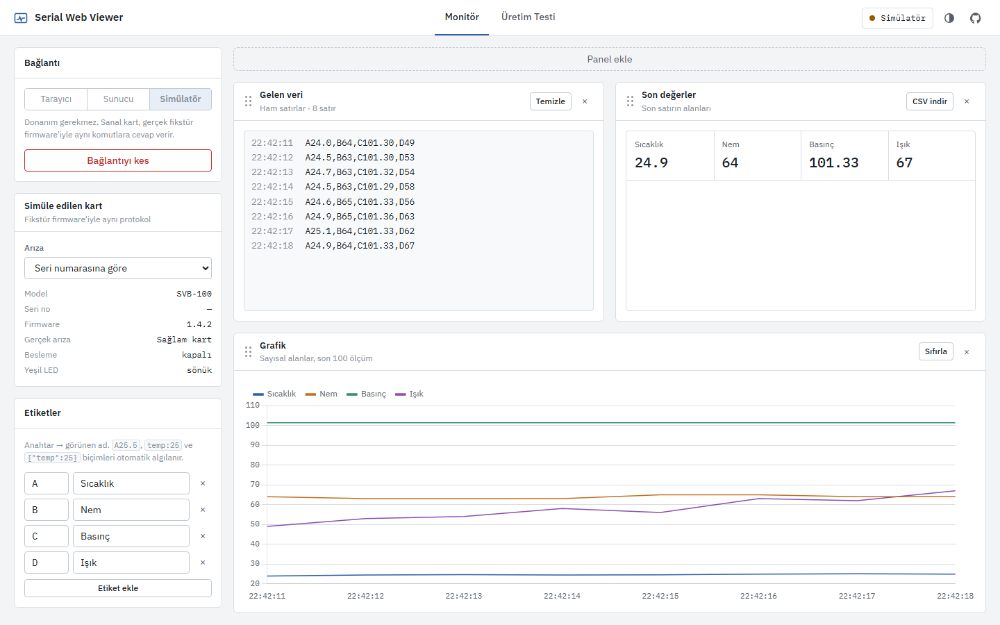

# Serial Web Viewer

[](https://github.com/sahintaha/serial-web-viewer/actions/workflows/ci.yml)
[](LICENSE)

Gömülü cihazlar için seri port aracı. İki iş yapar:

- **Monitör:** Seri porttan gelen satırları canlı izler, alanlara ayırır ve grafikle gösterir. Komut göndermek de buradan yapılır.
- **Üretim testi istasyonu:** Kartın seri numarası okutulur, karta sırayla komutlar gönderilir ve gelen cevaplar ürünün test reçetesine göre değerlendirilir. Sonuç PASS / FAIL / HATA olarak verilir ve kaydedilir.

Uygulama tarayıcıda (Web Serial API) ya da Node.js köprüsüyle çalışır. Donanım yoksa, gerçek fikstür firmware'iyle aynı protokolü konuşan bir **simülatör** kullanılabilir.

**Canlı demo** (simülatörle açılır):
- Monitör: [sahintaha.github.io/serial-web-viewer/?demo](https://sahintaha.github.io/serial-web-viewer/?demo)
- Test istasyonu: [sahintaha.github.io/serial-web-viewer/?demo#production](https://sahintaha.github.io/serial-web-viewer/?demo#production)

| Test istasyonu (FAIL alan bir kart) | Test kaydı detayı |
|:---:|:---:|
|  |  |
| **Monitör** | **Ürün ve reçete editörü** (koyu tema) |
|  |  |

---

## Test istasyonu nasıl çalışır

Elektronik kart üretiminde son adım fonksiyonel testtir. Her kart fikstüre takılır, ölçülür ve sonucu seri numarasıyla kaydedilir. Böylece aylar sonra "PCB-000142 hangi değerlerle, hangi test sürümüyle, kim tarafından geçti?" sorusu cevaplanabilir (izlenebilirlik).

1. Operatör **ürünü seçer** ve kartın **seri numarasını okutur**. Barkod okuyucu Enter gönderdiği için test kendiliğinden başlar. Numara ürünün maskesine uymalıdır (ör. `SNS-######`).
2. İstasyon, kartın geçmişine bakar:
   - Kart sınır kadar **FAIL** aldıysa test edilmez, **onarıma** yönlendirilir.
   - Daha önce **PASS** aldıysa operatöre tekrar test edilip edilmeyeceği sorulur.
3. Ürünün **reçetesi** adım adım çalışır. Örnek reçete:

   | # | Adım | Gönderilen | Beklenen |
   |---|---|---|---|
   | 1 | Seri numarasını yaz | `SN {serial}` | `OK` |
   | 2 | Kimlik ve firmware | `ID?` | `ID SVB-100 FW1.4.*` |
   | 3 | Beslemeyi aç | `PWR ON` | `OK` |
   | 4 | Oturma süresi | — | 300 ms bekle |
   | 5 | Besleme ölçümü | `MEAS?` × 5 | V 4.9–5.1 V, I 80–150 mA (ortalama) |
   | 6 | Sensör self-test | `SELFTEST` | `OK` |
   | 7 | LED kontrolü | `LED ON` | Operatöre sorulur: "LED yanıyor mu?" |
   | T | Teardown | `LED OFF`, `PWR OFF` | Her durumda çalışır |

4. **Karar:**
   - **PASS:** tüm adımlar geçti.
   - **FAIL:** kart arızalı (yanlış cevap, `@ERR`, limit dışı değer, operatörün "hayır" demesi).
   - **HATA:** test tamamlanamadı (cevap yok, eksik ölçüm, iptal, bağlantı koptu). HATA kartın değil istasyonun sorunudur, bu yüzden tekrar test sınırına sayılmaz.
5. Sonuç, adım verileri ve ham haberleşme kaydı (TX/RX) saklanır. Geçmiş ekranında her kaydın adım adım detayı açılır; filtrelenmiş sonuçlar CSV olarak indirilebilir.

Protokolün tamamı: [docs/protocol.md](docs/protocol.md).

### Tasarım kararları

- **Cevaplar `@` ile başlar.** Cihaz test sırasında telemetri göndermeye devam edebilir; istasyon yalnızca komuttan *sonra* gelen `@` satırlarını cevap kabul eder. Kart takılmadan önce gelmiş eski bir satır asla ölçüm sayılmaz.
- **Karar sunucuda yeniden hesaplanır.** İstasyon ham cevapları gönderir; sunucu aynı modülle (`public/js/recipe.js`) kararı kendisi verir. İstemci "PASS" yazıp gönderse bile kayıt değişmez.
- **Reçeteler sürümlüdür.** Bir ürün her değiştirilip kaydedildiğinde yeni bir revizyon oluşur ve test kaydı hangi revizyonla yapıldığını saklar. Eski kayıtlar, limitler sonradan değişse bile kendi revizyonlarıyla değerlendirilmiş kalır. Ürünler silinmez, arşivlenir.
- **Kullanıcı regex'i yok.** Seri no maskeleri (`#`, `@`, `?`) ve cevap kalıpları (`*`, `?`) doğrusal zamanlı eşleştirilir, böylece sunucu kötü yazılmış bir ifadeyle kilitlenemez.
- **Simülatör deterministiktir.** Bir kartın arızası seri numarasından türetilir. Aynı bozuk kart tekrar test edilince yine FAIL alır. "Aralıklı iletişim" arızalı kart ise ilk denemede HATA, ikincide PASS verir. Arıza türü elle de seçilebilir: aşırı akım, düşük voltaj, eski firmware, sensör, LED, cevapsız.

## Monitör

- Bağlantı modları:
  - **Tarayıcı:** Web Serial API ile USB porta doğrudan bağlanır (Chrome / Edge, kurulum yok).
  - **Sunucu:** Node.js + Socket.io köprüsü. Ayrı alıcı/verici port kullanılabilir; birden fazla sekme aynı bağlantıyı paylaşır.
  - **Simülatör:** donanım olmadan, komutlara cevap veren sanal kart.
- `A25.5,B60`, `temp:25;hum=60`, `{"temp":25}` ve `25,60` biçimleri otomatik algılanır; anahtarlar etiketlerle anlamlı adlara eşlenir.
- Ham log, son değerler ve grafik panelleri sürükle-bırak ile düzenlenir. Kaydedilen satırlar CSV olarak indirilebilir.
- Protokol cevapları (`@…`) logda ayrı renkte görünür; grafiklere karışmaz.

## Mimari

```
                      ┌──────────────────────── public/js ─────────────────────────┐
 USB ─ Web Serial ───▶│ WebSerialTransport ┐                                       │
 USB ─ server.js ────▶│ ServerTransport ───┼──▶ app.js (monitör)                   │
       (Socket.io)    │ DemoTransport ─────┘    production-ui.js ──▶ runner.js     │
                      │   └ simulator.js                                │          │
                      │                          recipe.js ◀────────────┘          │
                      │                          production.js  results-store.js ──┼──▶ /api (SQLite)
                      └────────────────────────────────────────────────────────────┘   veya localStorage
```

| Dosya | Görev |
|---|---|
| `public/js/recipe.js` | Ürün/reçete doğrulama, seri no maskesi, cevap kalıbı, adım ve test kararı. Tarayıcı ve sunucu ortak kullanır. |
| `public/js/runner.js` | Reçeteyi çalıştırır: komut gönder, cevap bekle, zaman aşımında tekrar dene, iptalde de teardown çalıştır |
| `public/js/simulator.js` | Protokolü konuşan sanal kart (arıza enjeksiyonu ile) |
| `public/js/production.js` | Test kaydı doğrulama, CSV, istatistik, tekrar test kuralı |
| `public/js/production-ui.js` | İstasyon, geçmiş ve ürün editörü ekranları |
| `public/js/results-store.js` | Sunucu (SQLite) veya tarayıcı deposu, aynı arayüzle |
| `public/js/parser.js`, `transports.js`, `app.js` | Satır ayrıştırma, bağlantılar, monitör arayüzü |
| `server.js`, `db.js` | Express + Socket.io köprüsü, REST API, SQLite şeması ve sürüm geçişleri |
| `examples/arduino/svb_fixture` | Aynı protokolü uygulayan gerçek kart firmware'i |

Frontend'de framework veya bundler yok; doğrudan tarayıcıda çalışan ES modülleri kullanılıyor. Bu yüzden aynı dosyalar hem GitHub Pages'te hem Node sunucusunda hem de testlerde çalışıyor.

## Çalıştırma

**Sadece tarayıcı:** canlı demoyu açın. Gerçek kart için Tarayıcı modunu seçip Bağlan'a basın; test istasyonu sonuçları bu durumda tarayıcı deposuna yazar.

**Node.js sunucusu ile** (SQLite kaydı, ayrı RX/TX portu):

```bash
git clone https://github.com/sahintaha/serial-web-viewer.git
cd serial-web-viewer
npm install
npm start
```

Ardından `http://localhost:3000` adresini açın. Node.js 22.13 veya üstü gerekir (yerleşik `node:sqlite` modülü için). Ayarlar `.env` dosyasından okunur (`.env.example`'a bakın):

| Değişken | Varsayılan | Açıklama |
|---|---|---|
| `PORT` | `3000` | HTTP portu |
| `HOST` | `127.0.0.1` | `0.0.0.0` yapılırsa ağdaki herkes cihaza yazabilir |
| `BAUD_RATE` | `9600` | Varsayılan baud rate |
| `DB_PATH` | `./data/serial-viewer.db` | SQLite dosyası. Eski sürüm veritabanları açılırken otomatik taşınır. |

**Docker:** `docker compose up -d` komutuyla çalışır. Seri cihaz için `docker-compose.yml` içindeki `devices` bölümünü açın; veriler `./data` klasöründe kalır.

**Gerçek kart:** [`examples/arduino/svb_fixture`](examples/arduino/svb_fixture/svb_fixture.ino) dosyasını bir Arduino Uno / Nano'ya yükleyin. Kablo bağlantıları dosyanın başında yazılı. Baud rate 115200'dür.

## REST API

| Metot | Uç | Açıklama |
|---|---|---|
| GET | `/api/products` | Ürünler (güncel revizyon) |
| GET | `/api/products/:code?revision=n` | Belirli bir revizyon |
| PUT | `/api/products/:code` | Kaydet; tanım değiştiyse yeni revizyon oluşur |
| DELETE | `/api/products/:code` | Arşivle (silmez) |
| GET | `/api/units/:serial?product=` | Kartın deneme sayısı, FAIL sayısı, engelli olup olmadığı |
| POST | `/api/tests` | Test kaydı: `{ serial, productCode, recipeRevision, startedAt, finishedAt, steps, teardown, error?, log? }`. Karar sunucuda hesaplanır. |
| GET | `/api/tests?serial=&product=&result=&from=&to=` | Sorgu ve istatistik |
| GET | `/api/tests/:id`, `/api/tests/export.csv` | Tek kayıt, CSV rapor |
| GET | `/health`, `/ports` | Durum, seri port listesi |

Geçersiz istekler `400 { errors: [...] }` döner. Socket.io olayları (`select-ports`, `send-manual`, `serial-data`, `connection-status`) `server.js` içinde belgelenmiştir.

## Testler

```bash
npm test       # node:test
npm run lint   # ESLint
```

- **Reçete mantığı:** doğrulama hata mesajları, maske ve kalıp eşleme (geri izleme patlaması dahil), adım ve test kararları.
- **Runner + simülatör entegrasyonu:** gerçek reçeteler, bellek içi bir "seri hat" üzerinden simülatöre karşı çalışır. Her arıza türünün doğru sonucu verdiği, aralıklı arızanın tekrar testte geçtiği, iptalde teardown'un kartı kapattığı doğrulanır.
- **REST API ve SQLite:** revizyonlar, arşivleme, istemci kararının yok sayılması, tekrar test kuralı, filtreler, CSV, eski veritabanının taşınması.

CI her push'ta bunları Node 22 ve 24'te çalıştırır ve `main` dalını GitHub Pages'e yayınlar.

## Bilinen sınırlamalar

- **Protokolde istek kimliği yok.** Zaman aşımından sonra gelen geç bir cevap, sıradaki komutun cevabı sanılabilir. `timeoutMs` cihazın en kötü cevap süresinin rahatça üstünde tutulmalı. Cevaba sıra numarası eklemek bu sınırlamayı kaldırır.
- **Tek istasyon, tek kart.** Paralel test için her port ayrı bir istasyon olmalı.
- **Kimlik doğrulama yok.** Operatör adı serbest metin; ürün ve reçete değişikliğini herkes yapabilir. Bir üretim ortamında rol bazlı yetki gerekir.
- **GitHub Pages demosunda kayıtlar sadece o tarayıcıda** (localStorage) tutulur.
- **Simülatör gerçek bir kart değildir.** Protokol ve test akışı gerçek; ölçümler sentetik.

## Yol haritası

- **Kalite raporları:** günlük verim, ilk seferde geçme oranı (FPY), hata sebebi Pareto grafiği, ölçüm dağılımı ve Cpk
- Kart başına yazdırılabilir test raporu
- `@serialport/binding-mock` ile sunucu tarafı seri port testleri, Playwright ile arayüz testleri
- Monitör: duraklat, ara, HEX görünüm, logu dosyaya kaydet

## Sorun giderme

- **Tarayıcı modu seçilemiyor:** Firefox ve Safari Web Serial desteklemiyor; Chrome / Edge veya Sunucu modunu kullanın.
- **Linux'ta port görünmüyor:** `sudo usermod -a -G dialout $USER` komutunu çalıştırıp oturumu yeniden açın.
- **Anlamsız karakterler geliyor:** baud rate, firmware'deki `Serial.begin(...)` değeriyle aynı olmalı (fikstür firmware'i için 115200).

## Lisans

[MIT](LICENSE) © Taha Şahin
