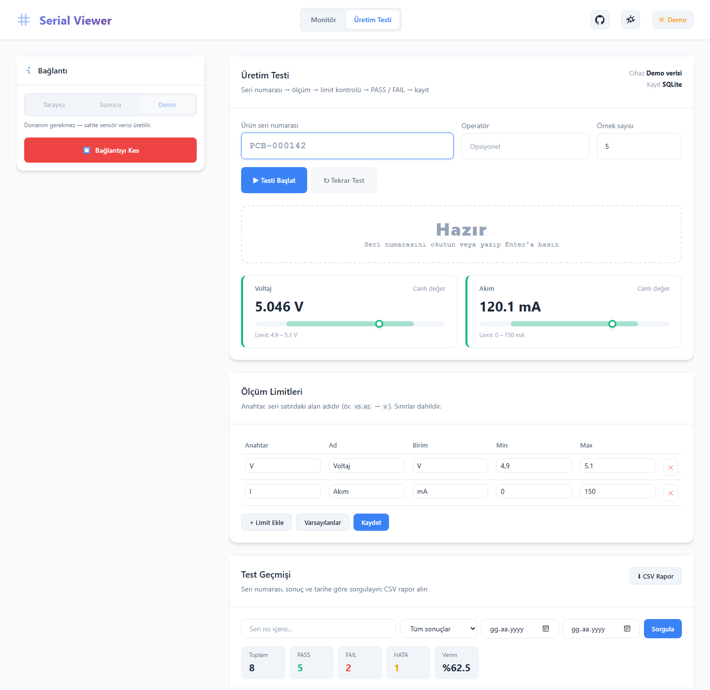

# 🔌 Serial Web Viewer

[](https://github.com/sahintaha/serial-web-viewer/actions/workflows/ci.yml)
[](https://sahintaha.github.io/serial-web-viewer/?demo)

[](LICENSE)

**Arduino ve gömülü cihazlar için gerçek zamanlı seri port monitörü.** Kurulum gerektirmeden tarayıcıda çalışır (Web Serial API). İsterseniz Node.js köprüsüyle de kullanabilirsiniz. **Üretim Testi** modunda, seri numarası okutulan kartları ölçüm limitlerine göre otomatik olarak PASS / FAIL diye işaretler ve sonuçları SQLite'a kaydeder.

### 👉 [Canlı demo: sahintaha.github.io/serial-web-viewer](https://sahintaha.github.io/serial-web-viewer/?demo)

Üretim testi demosu: [sahintaha.github.io/serial-web-viewer/?demo#production](https://sahintaha.github.io/serial-web-viewer/?demo#production)

Donanımınız yoksa demo sahte sensör verisiyle açılır. Arduino'nuzu USB ile takıp **Tarayıcı** modunda **Bağlan**'a basarsanız gerçek veriniz görünür (Chrome / Edge).

| Açık tema | Koyu tema |
|:---:|:---:|
|  |  |

| Üretim testi |
|:---:|
|  |

---

## ✨ Özellikler

- **3 bağlantı modu**
  - **Tarayıcı**: Web Serial API ile USB porta doğrudan bağlanır. Sunucu ve kurulum gerekmez.
  - **Sunucu**: Node.js + Socket.io köprüsü. Ayrı alıcı/verici port kullanılabilir ve birden fazla sekme aynı bağlantıyı paylaşır.
  - **Demo**: donanım olmadan sahte sensör verisi üretir.
- **Format algılama**: `A25.5,B60`, `temp:25;hum=60`, `{"temp":25}` ve düz `25,60` biçimlerini otomatik tanır.
- **Etiketleme**: anahtarları anlamlı adlara eşler (`A` → Sıcaklık). Tanımlanmamış alanlar da gösterilir.
- **Canlı grafik**: Chart.js ile son 100 ölçümü çizer. Eksik değerler boşluk olarak kalır, zaman ekseni kaymaz.
- **CSV dışa aktarma**: kaydedilen tüm satırları (en fazla 10.000) Excel'de açılabilen bir CSV olarak indirir.
- **Komut gönderme**: tek seferlik ya da belirli aralıklarla tekrarlanan komutlar gönderilebilir.
- **Ayarlanabilir panel düzeni**: paneller sürükle-bırak ile sıralanır, eklenip silinebilir. Düzen, etiketler, tema ve baud rate hatırlanır.
- **Performans**: gelen satırlar her animation frame'de toplu olarak çizilir ve ham log 500 satırla sınırlıdır; hızlı cihazlarda bile sayfa donmaz.
- **Güvenlik**: cihazdan gelen veri her zaman `textContent` ile basılır (XSS yok). Sunucu varsayılan olarak yalnızca `127.0.0.1` adresini dinler, girdiler doğrulanır.

## 🏭 Üretim Testi (Production Test)

Elektronik kart üretim hattındaki son test istasyonunu modelliyor:

1. **Seri numarası**: operatör kartın barkodunu okutur. Barkod okuyucu Enter gönderdiği için test kendiliğinden başlar. Format doğrulanır: `PCB-000142` gibi 3–40 karakter, harf/rakam/`-`/`_`.
2. **Ölçüm toplama**: her limit için ayarlanabilir sayıda (varsayılan 5) geçerli örnek toplanır. Bozuk ya da eksik satırlar atlanır ve sayılır.
3. **Limit kontrolü**: her ölçümün ortalaması `[min, max]` aralığıyla karşılaştırılır; sınırlar dahildir. Limitler arayüzden düzenlenir ve doğrulanır (tekrarlanan anahtar, min > max, sayı olmayan değer…).
4. **Karar**:
   - **PASS**: tüm ölçümler limit içinde.
   - **FAIL**: en az bir ölçüm limit dışında; sebep yazılır, ör. `Akım limit dışı (157.2 mA > 150 mA)`.
   - **HATA**: kart değil test hatalı. Zaman aşımı (15 sn), test sırasında bağlantı kopması, çok fazla bozuk veri veya operatör iptali bu gruba girer.
5. **Kayıt**: sonuç, ölçümler ve o anki limitlerin kopyası saklanır. Aynı seri numarasının her tekrar testi yeni bir **deneme** (attempt) olarak kaydedilir.
6. **Geçmiş ve rapor**: seri numarası, sonuç ve tarih aralığına göre sorgulanır. PASS / FAIL / HATA sayıları ve verim (%) gösterilir, CSV rapor indirilebilir.

Karar mantığı (`public/js/production.js`) tarayıcıda ve sunucuda **aynı modül** olarak çalışır. Sunucu, istemciden gelen sonucu kabul etmez; ham örneklerden kararı kendisi yeniden hesaplar.

| Ortam | Kayıt yeri |
|---|---|
| `npm start` (Sunucu) | SQLite: `data/serial-viewer.db` (`test_results` + `measurements` tabloları) |
| GitHub Pages demosu | Tarayıcı deposu (localStorage), aynı doğrulama ve arayüz |

## 🏗️ Mimari

```
                     ┌─────────── public/js ───────────┐
 USB ── Web Serial ─▶│ WebSerialTransport ┐            │
                     │ DemoTransport ─────┼─▶ parser ─▶│─▶ Panels (log, chips, chart, CSV)
 USB ── server.js ──▶│ ServerTransport ───┘  (pure)    │
       (Socket.io)   └─────────────────────────────────┘
```

| Dosya | Görev |
|---|---|
| `public/js/parser.js` | Satır ayrıştırma, satır bölme ve CSV üretimi. DOM'a dokunmayan saf fonksiyonlardır ve birim testleri vardır. |
| `public/js/transports.js` | Ortak arayüze sahip üç veri kaynağı: Web Serial, Socket.io ve Demo |
| `public/js/app.js` | Arayüz durumu, paneller ve grafik |
| `public/js/production.js` | Seri no / limit doğrulama, PASS-FAIL kararı, CSV rapor. Tarayıcı ve sunucu ortak kullanır. |
| `public/js/production-ui.js` | Üretim testi ekranı: test akışı, zaman aşımı, bağlantı kopması |
| `public/js/results-store.js` | Sonuç deposu: SQLite API'si veya tarayıcı deposu |
| `server.js` | Express + Socket.io köprüsü ve REST API |
| `db.js` | SQLite şeması ve sorgular (Node'un yerleşik `node:sqlite` modülü) |

Frontend'de bundler veya framework yok; doğrudan tarayıcıda çalışan ES modülleri kullanılıyor. Bu sayede GitHub Pages'e olduğu gibi yüklenebiliyor.

## 🚀 Kurulum

### Sadece tarayıcı
[Canlı demoyu](https://sahintaha.github.io/serial-web-viewer/) açın, **Tarayıcı** modunu seçip **Bağlan**'a basın. Chrome veya Edge gerekir.

### Node.js köprüsü ile

```bash
git clone https://github.com/sahintaha/serial-web-viewer.git
cd serial-web-viewer
npm install
npm start
```

Ardından `http://localhost:3000` adresini açın. Ayarlar için `.env.example` dosyasını `.env` olarak kopyalayın:

| Değişken | Varsayılan | Açıklama |
|---|---|---|
| `PORT` | `3000` | Web arayüzünün HTTP portu |
| `HOST` | `127.0.0.1` | Dinlenecek arayüz. `0.0.0.0` yaparsanız ağdaki herkes cihazınıza yazabilir. |
| `BAUD_RATE` | `9600` | Varsayılan baud rate (arayüzden de değiştirilebilir) |
| `DB_PATH` | `./data/serial-viewer.db` | Üretim testi sonuçlarının SQLite dosyası |

### Docker

```bash
docker compose up -d
```

Seri cihazı container'a vermek için `docker-compose.yml` içindeki `devices` bölümünü açın. Test sonuçları `./data` klasöründe kalıcı olarak saklanır.

## 🔧 Arduino örneği

[`examples/arduino/sensor_stream`](examples/arduino/sensor_stream/sensor_stream.ino) her saniye `A<sıcaklık>,B<nem>,C<pot>,D<ışık>,V<voltaj>,I<akım>` satırını yollar (V ve I, üretim testi limitleriyle eşleşir) ve arayüzden gelen `LED:ON`, `LED:OFF`, `RATE:500` komutlarına `ACK:` ile yanıt verir.

## 📡 Socket.io API (Sunucu modu)

| Yön | Olay | Veri |
|---|---|---|
| İstemci → Sunucu | `select-ports` | `{ receiverPath, transmitterPath?, baudRate }` |
| İstemci → Sunucu | `disconnect-ports` | — |
| İstemci → Sunucu | `send-manual` | `string` (en fazla 1024 karakter) |
| Sunucu → İstemci | `serial-data` | `string` (tek satır) |
| Sunucu → İstemci | `connection-status` | `{ connected, receiverPath, transmitterPath, baudRate, error? }` |
| Sunucu → İstemci | `send-error` | `string` |

## 🌐 REST API

| Metot | Uç | Açıklama |
|---|---|---|
| GET | `/health` | `{ status, connected, storage }` |
| GET | `/ports` | Seri port listesi |
| POST | `/api/tests` | Test kaydı: `{ serial, operator?, sampleCount, startedAt, finishedAt, limits, samples, error? }`. Karar sunucuda hesaplanır, `201` + kayıt döner. |
| GET | `/api/tests` | Sorgu: `?serial=&result=&from=&to=&limit=&offset=` (`result`: PASS, FAIL veya ERROR), `{ items, stats }` döner |
| GET | `/api/tests/:id` | Tek kayıt ve ölçümleri |
| GET | `/api/tests/export.csv` | Aynı filtrelerle CSV rapor |

Geçersiz girdiler `400 { errors: [...] }` döndürür.

## 🧪 Geliştirme

```bash
npm run dev    # nodemon ile otomatik yeniden başlatma
npm test       # node:test — parser, üretim testi mantığı, REST API + SQLite
npm run lint   # ESLint
```

Her push'ta GitHub Actions, Node 22 ve 24 üzerinde lint ve testleri çalıştırır. `main` dalına gelen değişiklikler `public/` klasörünü otomatik olarak GitHub Pages'e yayınlar.

## 📋 Yol haritası

- [x] Web Serial API ile sunucusuz mod ve canlı demo
- [x] CSV dışa aktarma
- [x] Docker desteği
- [x] Birim testleri ve CI
- [x] Üretim testi: limitler, PASS/FAIL, SQLite kayıt, CSV rapor
- [ ] HEX / binary görünüm
- [ ] Eşik alarmları ve gauge widget'ları
- [ ] Oturum kaydı ve tekrar oynatma
- [ ] MQTT köprüsü
- [ ] TypeScript'e geçiş

## 🐛 Sorun giderme

- **Tarayıcı modu pasif**: Firefox ve Safari Web Serial desteklemiyor. Chrome veya Edge kullanın ya da Sunucu modunu deneyin.
- **Port listede yok (Linux)**: `sudo usermod -a -G dialout $USER` komutunu çalıştırıp oturumu yeniden açın.
- **Clone Arduino (CH340)**: ilgili USB-serial sürücüsünü kurun.
- **Veri anlamsız karakterler**: baud rate'in Arduino kodundaki `Serial.begin(...)` değeriyle aynı olduğundan emin olun.

## 📄 Lisans

[MIT](LICENSE) © Taha Şahin
