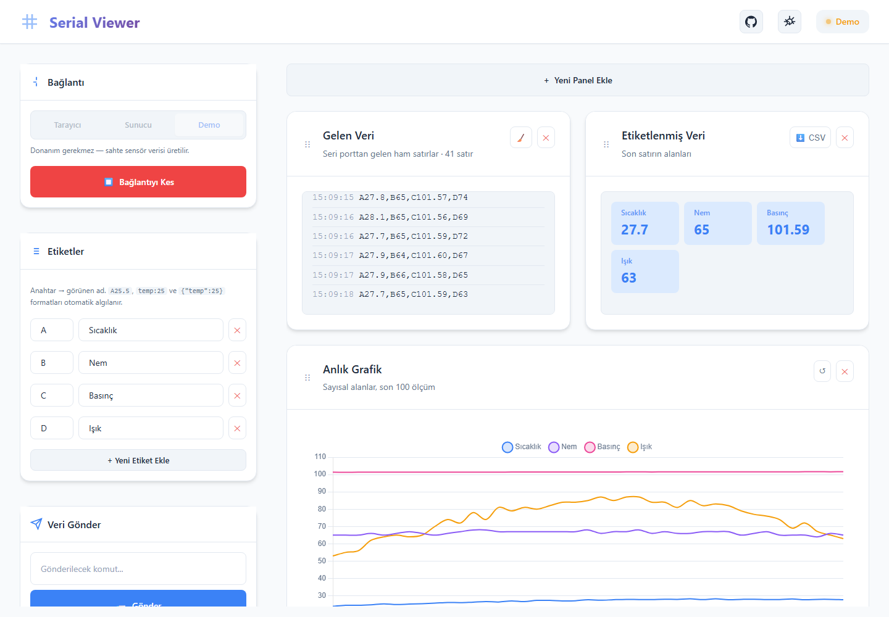
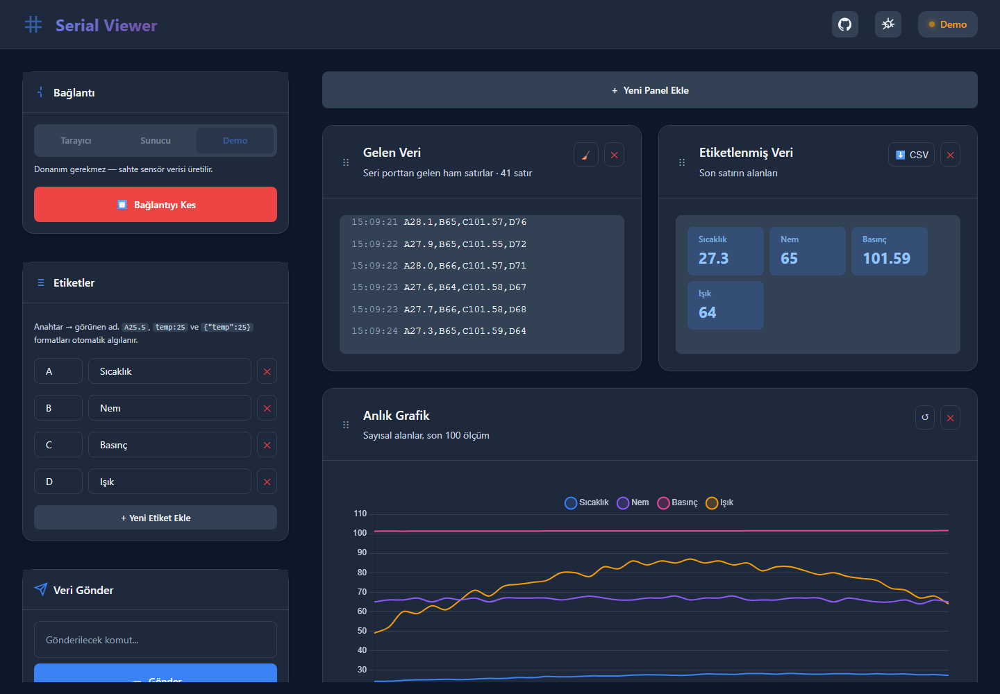

# 🔌 Serial Web Viewer

<div align="center">


**Modern, real-time serial port monitor for Arduino and embedded devices**

[Features](#-features) • [Installation](#-installation) • [Usage](#-usage) • [API](#-api) • [Contributing](#-contributing)

</div>

---

## 📸 Screenshots

<div align="center">
<table>
<tr>
<td align="center"><strong>Light Theme</strong></td>
<td align="center"><strong>Dark Theme</strong></td>
</tr>
<tr>
<td></td>
<td></td>
</tr>
</table>
</div>

---

## ✨ Features

### Core Features
- 🔄 **Real-time Data Streaming** — View serial port data instantly via WebSocket
- 📊 **Live Charts** — Beautiful, animated charts with Chart.js
- 🏷️ **Custom Data Labels** — Map prefixes to meaningful names (A → Temperature, B → Humidity)
- 🌓 **Dark/Light Theme** — Eye-friendly themes with smooth transitions
- 📱 **Responsive Design** — Works on desktop, tablet, and mobile

### Advanced Features
- 🔀 **Dual Port Support** — Separate receiver and transmitter ports
- 📤 **Manual & Auto Send** — Send data manually or at custom intervals
- 🧪 **Test Mode** — Simulate data without Arduino for development
- 🎯 **Drag & Drop Panels** — Customize your dashboard layout
- 💾 **Persistent Settings** — Theme and layout saved to localStorage

---

## 🛠️ Tech Stack

| Category | Technology |
|----------|------------|
| **Runtime** | Node.js 18+ |
| **Backend** | Express.js, Socket.io |
| **Serial Communication** | serialport, @serialport/parser-readline |
| **Frontend** | Vanilla JavaScript (ES6+) |
| **Charts** | Chart.js |
| **Drag & Drop** | Sortable.js |
| **Styling** | Modern CSS (Variables, Flexbox, Grid) |

---

## 📦 Installation

### Prerequisites

- [Node.js](https://nodejs.org/) v18 or higher
- npm or yarn
- Arduino or any serial device (optional for test mode)

### Quick Start

```bash
# Clone the repository
git clone https://github.com/yourusername/serial-web-viewer.git

# Navigate to project directory
cd serial-web-viewer

# Install dependencies
npm install

# Start the server
npm start
```

The application will be available at `http://localhost:3000`

### Development Mode

```bash
# Run with auto-reload (nodemon)
npm run dev
```

---

## 🚀 Usage

### 1. Connect Your Device

1. Connect your Arduino or serial device to your computer
2. Open `http://localhost:3000` in your browser
3. Select the **Receiver Port** from the dropdown
4. (Optional) Select a **Transmitter Port** for bidirectional communication
5. Click **Connect**

### 2. Configure Data Labels

Map your data prefixes to meaningful labels:

| Prefix | Label | Example Data |
|--------|-------|--------------|
| A | Temperature | A25.5 → Temperature: 25.5 |
| B | Humidity | B60 → Humidity: 60 |
| C | Pressure | C1013 → Pressure: 1013 |
| D | Light | D500 → Light: 500 |

### 3. Arduino Example Code

```cpp
void setup() {
  Serial.begin(9600);
}

void loop() {
  float temperature = analogRead(A0) * 0.48828125;
  int humidity = analogRead(A1) / 10;
  int pressure = 1000 + random(30);
  int light = analogRead(A2);
  
  // Format: A<temp>,B<humidity>,C<pressure>,D<light>
  Serial.print("A");
  Serial.print(temperature, 1);
  Serial.print(",B");
  Serial.print(humidity);
  Serial.print(",C");
  Serial.print(pressure);
  Serial.print(",D");
  Serial.println(light);
  
  delay(1000);
}
```

### 4. Test Mode

Don't have an Arduino? No problem! Click **Test Mode** to simulate sensor data.

---

## 📡 API

### REST Endpoints

| Method | Endpoint | Description |
|--------|----------|-------------|
| GET | `/ports` | List available serial ports |

### WebSocket Events

#### Client → Server

| Event | Payload | Description |
|-------|---------|-------------|
| `select-ports` | `{ receiverPath, transmitterPath }` | Connect to serial ports |
| `disconnect-ports` | - | Disconnect from ports |
| `send-manual` | `string` | Send data to transmitter port |
| `start-auto-send` | `message, interval` | Start auto-send loop |
| `stop-auto-send` | - | Stop auto-send loop |

#### Server → Client

| Event | Payload | Description |
|-------|---------|-------------|
| `serial-data` | `string` | Incoming serial data |
| `connection-status` | `{ connected, error? }` | Connection state change |

---

## 📁 Project Structure

```
serial-web-viewer/
├── public/
│   ├── index.html      # Main HTML file
│   ├── script.js       # Frontend JavaScript
│   └── styles.css      # Styling
├── server.js           # Express + Socket.io server
├── package.json        # Dependencies & scripts
└── README.md           # Documentation
```

---

## ⚙️ Configuration

### Environment Variables

Create a `.env` file in the root directory:

```env
PORT=3000
BAUD_RATE=9600
```

### Baud Rate

Default baud rate is `9600`. To change it, modify `server.js`:

```javascript
receiverPort = new SerialPort({ 
  path: receiverPath, 
  baudRate: 115200  // Change this value
});
```

---

## 🤝 Contributing

Contributions are welcome! Please follow these steps:

1. Fork the repository
2. Create a feature branch (`git checkout -b feature/amazing-feature`)
3. Commit your changes (`git commit -m 'Add amazing feature'`)
4. Push to the branch (`git push origin feature/amazing-feature`)
5. Open a Pull Request

### Development Guidelines

- Follow existing code style
- Add comments for complex logic
- Test with real hardware when possible
- Update documentation for new features

---

## 📋 Roadmap

- [ ] TypeScript migration
- [ ] Docker support
- [ ] Data export (CSV, JSON)
- [ ] Alert/notification system
- [ ] Multiple chart types
- [ ] Data logging to file
- [ ] Electron desktop app
- [ ] Mobile app (React Native)

---

## 🐛 Troubleshooting

### Port not showing in list

- **Linux:** Add user to `dialout` group: `sudo usermod -a -G dialout $USER`
- **macOS:** Install CH340 drivers if using cheap Arduino clones
- **Windows:** Install appropriate USB-to-Serial drivers

### Permission denied error

```bash
# Linux
sudo chmod 666 /dev/ttyUSB0

# Or add udev rule for permanent fix
echo 'SUBSYSTEM=="tty", ATTRS{idVendor}=="1a86", ATTRS{idProduct}=="7523", MODE="0666"' | sudo tee /etc/udev/rules.d/99-serial.rules
```

### Data not displaying

- Verify baud rate matches your Arduino code
- Check if data format matches label configuration
- Use Test Mode to verify frontend is working

---

## 📄 License

This project is licensed under the MIT License - see the [LICENSE](LICENSE) file for details.

---

## 🙏 Acknowledgments

- [serialport](https://serialport.io/) - Serial port access for Node.js
- [Socket.io](https://socket.io/) - Real-time bidirectional communication
- [Chart.js](https://www.chartjs.org/) - Beautiful charts
- [Sortable.js](https://sortablejs.github.io/Sortable/) - Drag & drop functionality

---

<div align="center">

**Made with ❤️ for the maker community**

⭐ Star this repo if you find it useful!

</div>
