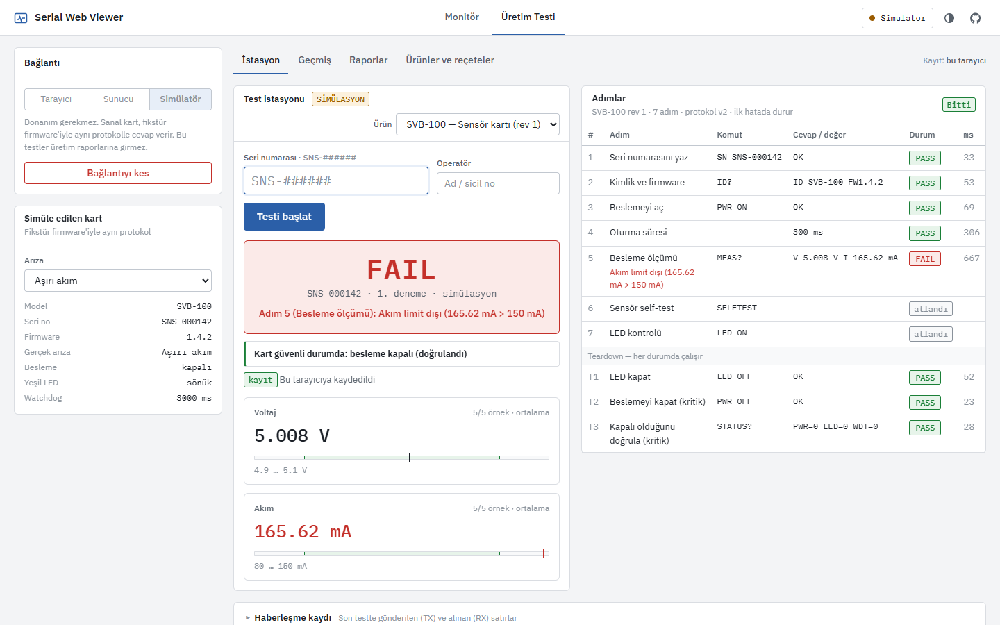
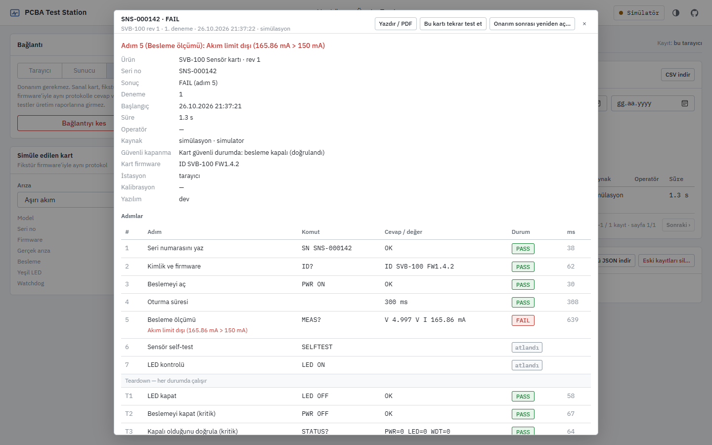
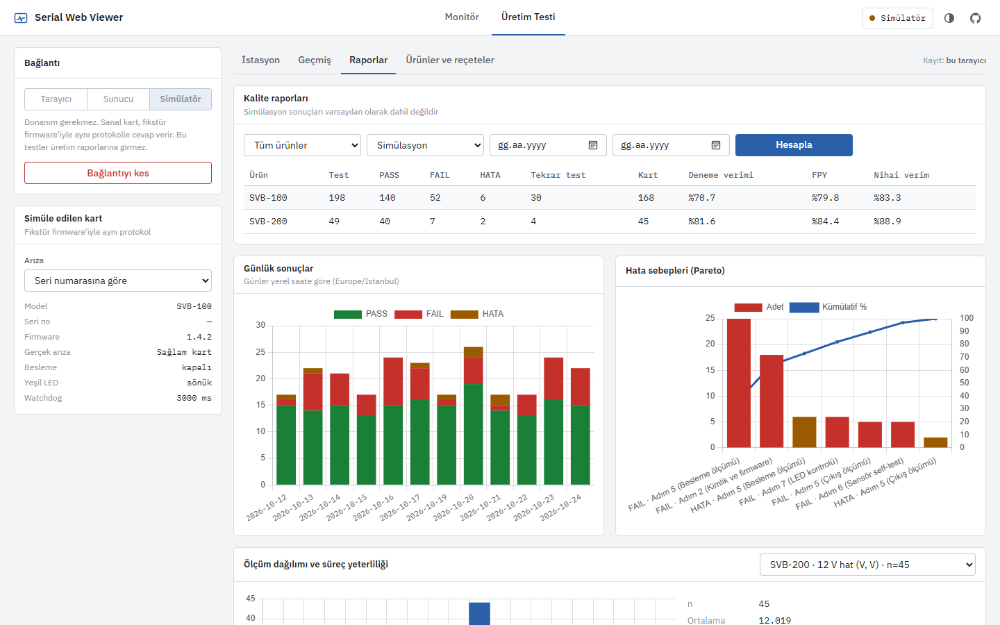
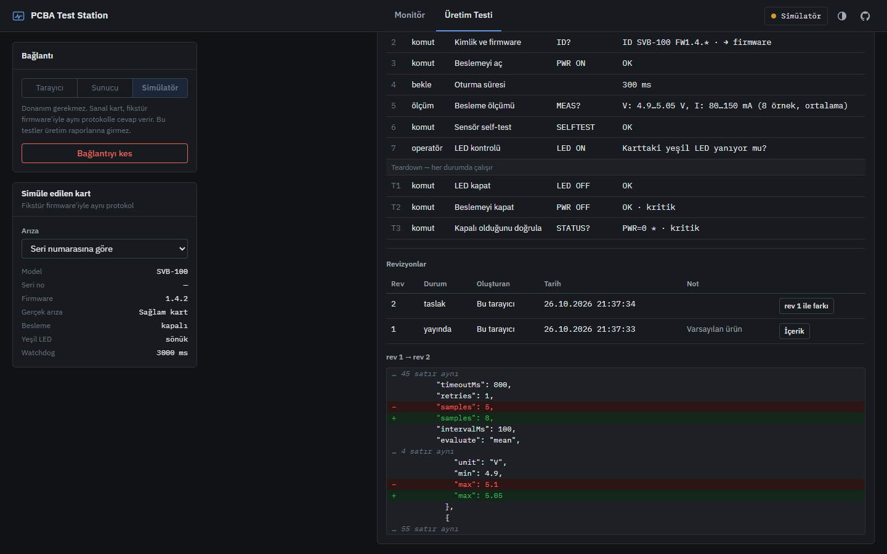

# PCBA Test Station

[](https://github.com/sahintaha/pcba-test-station/actions/workflows/ci.yml)
[](LICENSE)

[English](README.md) · **Türkçe**

Elektronik kartlar için web tabanlı **fonksiyonel test istasyonu**. Dizgisi yapılmış kartın seri numarası okutulur, karta sırayla komutlar gönderilir, ölçümler ürünün test reçetesindeki limitlerle karşılaştırılır. Sonuç PASS / FAIL / HATA olarak, kartın güvenli kapatılıp kapatılmadığıyla birlikte kaydedilir; kim, hangi istasyonda, hangi reçete revizyonuyla test etti, hepsi izlenebilir. Verim, Pareto ve Cpk raporları aynı verilerden çıkar.

Kurulum gerektirmeden tarayıcıda (Web Serial) ya da birden fazla kullanıcı ve merkezi veritabanı için Node.js sunucusuyla çalışır. Donanım yoksa, fikstür firmware'iyle aynı protokolü konuşan bir **simülatörle** denenebilir. Yanında bir **seri port monitörü** de var: ham veri, HEX, grafik ve komut gönderme.

**Canlı demo:** [sahintaha.github.io/pcba-test-station](https://sahintaha.github.io/pcba-test-station/?demo#production). Simülatöre bağlı açılır; "Sağlam kartı dene", "Arızalı kartı dene" ve "Örnek raporları gör" düğmeleriyle bir dakikada denenir. Kayıtlar yalnızca o tarayıcıda tutulur.

| Test istasyonu | Test kaydı detayı |
|:---:|:---:|
|  |  |
| **Kalite raporları** | **Reçete taslağı ve yayın farkı** (koyu tema) |
|  |  |

---

## Test istasyonu nasıl çalışır

Elektronik kart üretiminde son adım fonksiyonel testtir. Her kart fikstüre takılır, ölçülür ve sonucu seri numarasıyla kaydedilir. Böylece aylar sonra "SNS-000142 hangi değerlerle, hangi reçete revizyonuyla, hangi istasyonda, kim tarafından geçti?" sorusu cevaplanabilir.

1. Operatör ürünü seçer ve kartın **seri numarasını okutur** (barkod okuyucu Enter gönderir, test kendiliğinden başlar). Numara ürünün maskesine uymalıdır (ör. `SNS-######`).
2. İstasyon testi **sunucuda rezerve eder**. Tekrar test kuralı burada, tek bir veritabanı işleminde kontrol edilir; iki istasyon aynı kartın son hakkını aynı anda kullanamaz.
3. Ürünün **reçetesi** adım adım çalışır. Her komut bir istek kimliği taşır (`#00A1 MEAS?` → `@#00A1 V5.012,I118.3`); geç gelen bir cevap başka bir komutun cevabı sayılamaz.

   | # | Adım | Gönderilen | Beklenen |
   |---|---|---|---|
   | 1 | Seri numarasını yaz | `SN {serial}` | `OK` |
   | 2 | Kimlik ve firmware | `ID?` | `ID SVB-100 FW1.4.*` (sürüm kayda yazılır) |
   | 3 | Beslemeyi aç | `PWR ON` | `OK` |
   | 4 | Oturma süresi | — | 300 ms |
   | 5 | Besleme ölçümü | `MEAS?` × 5 | V 4.9–5.1 V, I 80–150 mA (ortalama) |
   | 6 | Sensör self-test | `SELFTEST` | `OK` |
   | 7 | LED kontrolü | `LED ON` | operatöre sorulur |
   | T | Teardown | `LED OFF`, `PWR OFF` (kritik), `STATUS?` → `PWR=0 *` (kritik) | her durumda çalışır |

4. İki ayrı sonuç üretilir:
   - **Karar** (kart hakkında): **PASS**; **FAIL** (yanlış cevap, `@ERR`, limit dışı, operatör "hayır" dedi); **HATA** (test tamamlanamadı: cevap yok, eksik veya geçersiz ölçüm, iptal, bağlantı koptu).
   - **Güvenli durum** (fikstür hakkında): **SAFE** (besleme kapandı ve ölçülerek doğrulandı), **UNSAFE** (kart besleme kapanmadı diyor), **UNVERIFIED** (doğrulanamadı). SAFE değilse istasyon bunu kırmızı gösterir ve operatör kontrol ettiğini onaylamadan yeni test başlatılamaz; bu onay sayfa yenilense de istenir.
5. Sonuç önce tarayıcıda kalıcı bir **gönderim kuyruğuna** yazılır, sonra sunucuya gönderilir. Bağlantı koparsa veya sunucunun cevabı kaybolursa kuyruk aynı `runId` ile tekrar gönderir; sunucu aynı kaydı ikinci kez eklemez.

Protokol, güvenli kapanma ve reçete biçimi: [docs/protocol.md](docs/protocol.md). Gerçek donanımda elle doğrulanması gerekenler: [docs/hardware-checklist.md](docs/hardware-checklist.md).

### Ölçüm doğruluğu

- Sayıya çevrilemeyen veya sonsuza taşan değerler (`NaN`, `Infinity`, `1e999`, metin) **geçersiz** sayılır; adım HATA olur, asla PASS olmaz.
- Reçetedeki örnek sayısından az ölçüm "eksik", fazla cevap "fazla örnek" olarak HATA verir.
- Değerlendirme modu (`mean`, `min`, `max`, `all`) reçete revizyonunun parçasıdır ve her sonuçla birlikte saklanır.
- Karar sunucuda, kaydın ait olduğu reçete revizyonuyla **yeniden hesaplanır**. İstasyon "PASS" yazıp gönderse bile kayıt değişmez. (Bu, fiziksel ölçümün gerçekten o fikstürden geldiğini kanıtlamaz; bkz. Sınırlamalar.)

## Kullanıcılar, roller ve izlenebilirlik (sunucu modu)

| Rol | Yapabildikleri |
|---|---|
| Operatör | Test yapar, geçmişi ve raporları görür, CSV indirir. Limitleri değiştiremez. |
| Mühendis | Ayrıca reçete taslağı hazırlar, yayınlar, ürün arşivler; FAIL sınırına ulaşmış kartı gerekçeyle yeniden açar. |
| Yönetici | Ayrıca kullanıcı ekler/devre dışı bırakır, veritabanı yedeği indirir. |

- Varsayılan parola yoktur. İlk açılışta sunucu konsola tek kullanımlık bir **kurulum kodu** yazar; ilk yönetici bu kodla oluşturulur.
- Operatör adı serbest metin değildir; kayıtlar oturum açan kullanıcının adıyla saklanır. Parolalar scrypt ile, oturumlar yalnızca SHA-256 özetiyle saklanır. REST istekleri ve Socket.io kontrol olayları (bağlan, gönder, kilitle, bağlantıyı kes) her seferinde oturumla yetkilendirilir; çıkış yapan veya devre dışı bırakılan kullanıcı portu hemen kontrol edemez.
- Sunucu sıkı bir Content-Security-Policy gönderir: betik, stil ve bağlantılar yalnızca sunucunun kendisinden; sayfadaki iki satır içi betik SHA-256 özetiyle izinli, `'unsafe-inline'` yok. Ayrıca `nosniff`, çerçeveye gömme yasağı ve kısıtlı izin politikası.
- Reçeteler **taslak → yayın** akışıyla değişir. Taslak istasyonu etkilemez; yayınlarken yayındaki revizyonla farkı gösterilir ve "neyi neden değiştirdiniz" notu zorunludur. Yayınlanmış revizyonlar değişmez.
- Kim, ne zaman, neyi, neden değiştirdi: reçete yayını, arşivleme, kart yeniden açma, PASS sonrası tekrar test, kullanıcı değişiklikleri ve yedekler denetim kaydına yazılır.
- Her test kaydında istasyon, fikstür, kalibrasyon kimliği ve son tarihi, uygulama sürümü, kartın firmware sürümü, kaynak (gerçek kart / simülasyon) ve bağlantı tipi bulunur. Kalibrasyon süresi dolmuş bir istasyon gerçek kart test edemez.

## Tekrar test kuralları

| Durum | Davranış |
|---|---|
| Kart hiç test edilmemiş | Test edilir. |
| Kart daha önce **PASS** aldı | Tekrar test için gerekçe istenir; gerekçe kayda ve denetim kaydına yazılır. |
| Kart son yeniden açılıştan beri ürünün "En fazla FAIL" sayısı kadar **FAIL** aldı | Test edilmez, onarıma yönlendirilir. Mühendis onarım gerekçesiyle yeniden açınca sayaç sıfırlanır; eski kayıtlar silinmez. |
| **HATA** sonuçları | FAIL sınırına sayılmaz (sorun genellikle istasyondadır), ama kendi sınırı vardır: "En fazla HATA" (varsayılan 3) kez tamamlanamayan kart da onarıma yönlendirilir. Hiç cevap vermeyen ölü bir kart böylece sonsuza kadar tekrar test edilemez. |
| Kart şu anda başka bir istasyonda testte | Reddedilir; mesaj kimin, hangi istasyonda, ne zamandan beri test ettiğini söyler. 30 dakikadan eski, bitmemiş rezervasyonlar terk edilmiş sayılır. |
| Test yarıda kaldı (sekme kapandı, tarayıcı çöktü) | İstasyon tekrar açılınca yarım kalan testin rezervasyonunu kendisi kapatır, sonucu kaydedilmemiş sayar ve operatör kartı kontrol ettiğini onaylamadan yeni teste izin vermez. Başka bir yerde yarım kalan test için sahibi veya bir mühendis "Yarım kalan testi kapat" diyebilir; denetim kaydına yazılır. |
| Seri numarası başka bir ürüne ait | Reddedilir (bir seri numarası tek ürüne aittir). |
| Reçete test başlarken güncellendi | Test başlamaz, istasyon yeni revizyonu yükler. Çalışan test başladığı revizyonla biter. |
| **Simülasyon** testleri | Ayrı tutulur: gerçek kartların deneme sayısını, FAIL sınırını ve üretim raporlarını etkilemez. |
| Eski sürümden gelen, kaynağı bilinmeyen kayıtlar | "Kaynak bilinmiyor" olarak işaretlenir ve ihtiyatlı olarak üretim verisine dahil edilir. |

Sunucusuz (tarayıcı) modda aynı kurallar uygulanır ama **yalnızca o tarayıcı için**: başka bir tarayıcının veya silinmiş bir profilin geçmişi görülemez. Merkezi garanti için sunucu kullanılmalıdır.

## Raporlar

- **Deneme verimi** = PASS test / tüm testler.
- **FPY (ilk seferde geçme)** = 1. denemesi dönemde olan kartlardan 1. denemede PASS alanlar.
- **Nihai verim** = dönemde PASS almış kart / test edilen kart.
- FAIL, HATA ve tekrar testler ayrı sütunlardadır. Günlük sonuç grafiği ve hata sebebi Pareto grafiği vardır.
- Günler, raporu açan kişinin saat diliminde sayılır (yaz saati ve yarım saatlik dilimler dahil); gece yarısından sonraki testler doğru güne yazılır. CSV'de başlangıç ve bitiş yerel saat olarak, `utc_offset` sütunuyla birlikte yazılır; Excel tarih olarak okur.
- **Ölçüm dağılımı ve Cpk:** Cpk yalnızca en az 30 ölçüm, dönem içinde tek bir limit seti ve sıfırdan büyük bir dağılım varsa gösterilir; kararlı ve yaklaşık normal bir süreç varsayar. Koşullar sağlanmazsa neden gösterilmediği yazılır.
- Tek bir kaydın yazdırılabilir raporu (kart başına test raporu) geçmiş ekranından alınır.
- Simülasyon sonuçları üretim raporlarına hiçbir zaman karışmaz; simülatöre bağlıyken raporlar ve geçmiş, kaynak olarak simülasyonu gösterir.

## Kurulum

### Sadece tarayıcı

Canlı demoyu açın: ilk açılışta simülatöre bağlanır. İstasyondaki **Sağlam kartı dene** / **Arızalı kartı dene** düğmeleri seri numarası yazmadan bir test çalıştırır (arızalı kartın gizli arızası her denemede değişir: aşırı akım, düşük voltaj, eski firmware, sensör, LED); **Örnek raporları gör** raporları doldurur. Telefonda demo açıkken test alanı bağlantı panelinin üstünde durur. **Geçmiş** veya **Raporlar** sayfasındaki "Örnek veri oluştur" düğmesi, simülatörle iki haftalık bir üretimi (≈250 test, gece vardiyası, arızalar, tekrar testler) birkaç saniyede çalıştırır; kayıtlar gerçek runner, simülatör ve kayıt kodundan geçer, yalnızca saat sanaldır ve hepsi "simülasyon" olarak işaretlenir. "Simülasyon kayıtlarını sil" ile kaldırılır. Gerçek kart için **Tarayıcı** modunu seçip Bağlan'a basın (Chrome / Edge). Sonuçlar tarayıcının IndexedDB deposunda tutulur; hiçbir kayıt kendiliğinden silinmez, depo durumu ve "tümünü dışa aktar" Geçmiş sayfasındadır. Tüm dosyalar (yazı tipleri, Chart.js, Sortable) projeyle gelir; internet bağlantısı gerekmez.

### Node.js sunucusu

Node.js **22.13 veya üstü** gerekir (yerleşik `node:sqlite`).

```bash
git clone https://github.com/sahintaha/pcba-test-station.git
cd pcba-test-station
npm ci
cp .env.example .env
npm start
```

Konsolda `İlk kurulum: … kurulum kodu: XXXX` satırını görün, `http://localhost:3000` adresini açın ve yönetici hesabını bu kodla oluşturun. Diğer kullanıcılar sağ üstteki menüden **Kullanıcılar** ile eklenir.

| Değişken | Varsayılan | Açıklama |
|---|---|---|
| `PORT` / `HOST` | `3000` / `127.0.0.1` | `0.0.0.0` yapılırsa ağdaki herkes arayüze ulaşır; o durumda önüne HTTPS'li bir ters vekil koyun |
| `BAUD_RATE` | `9600` | Varsayılan baud rate (arayüzden değiştirilebilir) |
| `DB_PATH` | `./data/serial-viewer.db` | SQLite dosyası |
| `STATION_ID`, `FIXTURE_ID` | bilgisayar adı, boş | Her kayda yazılır |
| `CALIBRATION_ID`, `CALIBRATION_DUE` | boş | Kalibrasyon kaydı; son tarih geçtiyse gerçek kart testi reddedilir |
| `BUILD_SHA` | boş | Kayıtlardaki uygulama sürümüne eklenir |

### Docker

```bash
cp .env.example .env        # STATION_ID, kalibrasyon, UID / GID
mkdir -p data               # .env'deki UID:GID'ye ait olmalı
docker compose up -d
docker compose logs         # kurulum kodu burada
```

Seri cihaz için `docker-compose.yml` içindeki `devices` ve `group_add` bölümlerini açın (`group_add`'a ana makinedeki `dialout` grubunun numarasını yazın: `getent group dialout`). Konteyner `/health` ile sağlık kontrolü yapar; `docker stop` portu kapatıp veritabanını düzgün kapatır.

### Gerçek kart

[`examples/arduino/svb_fixture`](examples/arduino/svb_fixture/svb_fixture.ino) dosyasını bir Arduino Uno / Nano'ya yükleyin (115200 baud). Kablo bağlantıları dosyanın başında yazılı. `STATUS?` beslemeyi pin durumundan değil A0'dan **ölçerek** bildirir; yapışmış bir röle bu yüzden yakalanır. Firmware CI'da her değişiklikte derlenir.

## Yükseltme ve veritabanı taşıma

1. **Yedek alın** (sunucu çalışırken alınabilir):
   ```bash
   node scripts/db.js backup yedek-2026-10-26.db
   ```
2. Sunucuyu durdurun (`Ctrl+C` veya `docker compose stop`).
3. Kodu güncelleyin: `git pull && npm ci` (Docker: `docker compose build`).
4. Başlatın. Şema açılışta otomatik taşınır (`PRAGMA user_version`, şu an 4). Her sürüm adımı ayrı bir veritabanı işlemidir; bir adım başarısız olursa veritabanı bir önceki tutarlı sürümde kalır ve sunucu başlamaz. Eski kayıtlar korunur ve kaynakları "bilinmiyor" olarak işaretlenir.
5. Bu sürümden itibaren oturum zorunludur: ilk açılışta konsoldaki kurulum koduyla yönetici oluşturun.
6. Uygulamanın tanımadığı **daha yeni** bir şemayla karşılaşırsa açılmayı reddeder (eski sürüme geri dönüldüğünde veri bozulmasın diye).

Geri dönmek gerekirse:

```bash
node scripts/db.js verify  yedek-2026-10-26.db   # bütünlük, yabancı anahtarlar, şema sürümü
node scripts/db.js restore yedek-2026-10-26.db   # sunucu kapalıyken
```

`restore` yedeği doğrular, mevcut veritabanının tutarlı bir kopyasını `<DB_PATH>.before-restore-<zaman>.db` olarak saklar, eski WAL/SHM dosyalarını siler, dosyayı atomik olarak değiştirir ve gerekiyorsa şemayı taşır. Sunucu çalışıyorsa reddeder.

**Tarayıcı modu:** önceki sürümün `localStorage` kayıtları ilk açılışta IndexedDB'ye bir kez aktarılır ve "kaynak bilinmiyor" olarak işaretlenir.

**Firmware:** protokol v2 istek kimlikleri, cevap önbelleği, watchdog, `PING` ve `STATUS?` ekler. Henüz güncellenmemiş bir fikstür için ürün ayarlarında protokolü **v1 (eski firmware)** seçin; bu mod açıkça seçilmedikçe kullanılmaz ve geç cevap koruması daha zayıftır (bkz. protokol belgesi).

## Mimari

```
                       ┌──────────────────────────── public/js ─────────────────────────────┐
 USB ─ Web Serial ────▶│ WebSerialTransport ┐                                               │
 USB ─ server.js ─────▶│ ServerTransport ───┼─▶ CommandChannel ─▶ monitor.js                 │
       (Socket.io,     │ DemoTransport ─────┘   (kimlik, kuyruk,   station.js ─▶ runner.js    │
        port kilidi)   │   └ simulator.js        kilit, heartbeat)        recipe.js           │
                       │                                                                     │
                       │ outbox.js ─▶ results-store.js ──▶ /api (SQLite)  veya  IndexedDB     │
                       └─────────────────────────────────────────────────────────────────────┘
```

| Dosya | Görev |
|---|---|
| `public/js/recipe.js` | Ürün/reçete doğrulama, seri no maskesi, cevap kalıbı, ölçüm değerlendirme ve test kararı. Tarayıcı ve sunucu ortak kullanır. |
| `public/js/channel.js` | Port başına komut kuyruğu, istek kimlikleri, test kilidi, heartbeat |
| `public/js/runner.js` | Reçeteyi çalıştırır; teardown her durumda, kritik adımlar tekrar denenerek |
| `public/js/station.js` | İstasyon durum makinesi: IDLE → CHECKING → RUNNING → TEARDOWN → SAVING → COMPLETED / ERROR |
| `public/js/outbox.js`, `local-db.js` | Kalıcı gönderim kuyruğu, IndexedDB (sekmeler arası atomik) |
| `public/js/results-store.js` | Sunucu ve tarayıcı deposu, aynı arayüzle |
| `public/js/production.js` | Kayıt doğrulama, tekrar test kuralı, CSV, verim ve Cpk |
| `public/js/history-ui.js`, `reports-ui.js`, `products-ui.js` | Geçmiş, raporlar, reçete editörü |
| `public/js/monitor.js` | Ham log, HEX, kayıt, grafikler, komut gönderme |
| `server.js`, `lib/` | Express, Socket.io köprüsü ve port kilidi, kimlik doğrulama, REST API |
| `db.js` | SQLite şeması, sürüm geçişleri, sayfalı sorgular, akışlı dışa aktarma, yedek |
| `examples/arduino/svb_fixture` | Protokolü uygulayan fikstür firmware'i |

Frontend'de framework veya bundler yok; tarayıcıda doğrudan çalışan ES modülleri kullanılıyor. Aynı dosyalar GitHub Pages'te, Node sunucusunda ve testlerde çalışıyor.

## REST API (özet)

Tüm uçlar oturum ister (`/health` hariç). Hatalar `{ errors: [...], code? }` döner.

| Metot | Uç | Rol |
|---|---|---|
| GET | `/api/products`, `/api/products/:code[?revision=n]` | operatör |
| GET/PUT/DELETE | `/api/products/:code/draft` | mühendis |
| POST | `/api/products/:code/publish` (`note` zorunlu), `/archive` (`reason` zorunlu), `/restore` | mühendis |
| GET | `/api/products/:code/revisions` (revizyonlar ve denetim kaydı) | mühendis |
| GET | `/api/units/:serial?product=&source=` | operatör |
| POST | `/api/units/:serial/reopen` (`reason` zorunlu) | mühendis |
| POST | `/api/runs` (rezervasyon), `/api/runs/:runId/abandon` | operatör |
| POST | `/api/tests` (`runId` ile idempotent; karar sunucuda hesaplanır) | operatör |
| GET | `/api/tests?…&limit=&offset=` (özet + toplam), `/api/tests/:id` (detay), `/api/tests/export.csv` (akışlı) | operatör |
| GET | `/api/reports`, `/api/reports/measurement?product=&key=` | operatör |
| GET | `/api/audit` | mühendis |
| GET | `/api/admin/backup`, `/api/users` … | yönetici |

## Testler

```bash
npm test             # birim ve entegrasyon testleri (node:test)
npm run test:e2e     # Playwright; yerelde kurulu Edge ile: PW_CHANNEL=msedge npm run test:e2e
npm run lint
```

- **Ölçüm ve karar:** NaN / Infinity / taşma, eksik ve fazla örnek, değerlendirme modları, kayıt-reçete uyumu.
- **Protokol ve kanal:** geç `@OK`, yinelenen cevap, kuyruk sırası, test kilidi, v1 koruma penceresi, heartbeat.
- **Runner + simülatör:** her arıza türü, iptal, beklenmeyen hata, bağlantı kopması, yapışmış röle, watchdog.
- **Sunucu (SerialPortMock ve gerçek Socket.io istemcileri):** port kilidi, başka sekmeden yazma/bağlantı kesme, hızlı yeniden bağlanma, kaybolan port, roller, rezervasyon yarışı, idempotent kayıt, CSV formül enjeksiyonu, 3000 satırlık akışlı dışa aktarma, şema taşıma, yedek ve geri yükleme.
- **Tarayıcı deposu (fake-indexeddb):** sekmeler arası rezervasyon, gönderim kuyruğu, depolama hatası, eski veri aktarımı.
- **Uçtan uca (Playwright):** simülatörle test, çift başlatma, güvenli olmayan kart, test sırasında gönderim kilidi, operatör sorusundan testi durdurma, sayfa kapanınca yarım kalan testin kurtarılması, taslak/yayın, FAIL sınırı ve yeniden açma, örnek veri, ilk ziyarette simülatör; sunucu modunda ilk kurulum, sahte seri porttan gerçek kart testi, tüm ekranların CSP altında hatasız çalışması, iki sekme, kaybolan kayıt cevabı + sayfa yenileme, kablo çıkarma, PASS sonrası gerekçe, yetkisiz değişiklik ve denetim kaydı.

CI her push'ta birim testlerini Node 22 ve 24'te, uçtan uca testleri Chromium'da çalıştırır, fikstür firmware'ini derler ve ancak hepsi geçerse `main`'i GitHub Pages'e yayınlar.

## Bilinen sınırlamalar

- **Sunucunun kararı yeniden hesaplaması, ölçümün nereden geldiğini kanıtlamaz.** Değiştirilmiş bir tarayıcının sahte PASS yazmasını engeller; yanlış bağlanmış veya kalibrasyonu kaymış bir fikstürü yakalamaz. Bunun için [donanım kontrol listesi](docs/hardware-checklist.md) ve kalibrasyon kaydı gerekir.
- **Tarayıcı modunda merkezi garanti yok.** Kullanıcı, rol ve denetim kaydı yalnızca sunucu modunda vardır; tekrar test kuralları tarayıcı başınadır.
- **Tek istasyon, tek kart.** Paralel test için her port ayrı bir istasyon olmalıdır.
- **Web Serial modu otomatik test edilmiyor.** Tarayıcının port seçme penceresi otomasyona kapalı; bu mod elle doğrulanır.
- **Sunucu HTTPS sunmaz.** Ağa açılacaksa önüne TLS'li bir ters vekil konmalıdır (çerez o durumda `Secure` olarak işaretlenir).
- **Simülatör gerçek bir kart değildir.** Protokol ve test akışı gerçek; ölçümler sentetik.

## Sorun giderme

- **Tarayıcı modu seçilemiyor:** Firefox ve Safari Web Serial desteklemiyor; Chrome / Edge veya Sunucu modunu kullanın.
- **Linux'ta port görünmüyor:** `sudo usermod -a -G dialout $USER`, ardından oturumu yeniden açın. Docker'da `group_add` kullanın.
- **Anlamsız karakterler:** baud rate ve satır ayarları (data bits, parity, stop bits) firmware'dekiyle aynı olmalı; fikstür firmware'i 115200 8N1.
- **"Port … tarafından test için kilitli":** başka bir sekme veya istasyon bu portta test çalıştırıyor; test bitince kilit kalkar.
- **Kurulum kodunu kaçırdım:** kullanıcı yokken sunucu her başlangıçta kodu yeniden yazar.

## Lisans

[MIT](LICENSE) © Taha Şahin
